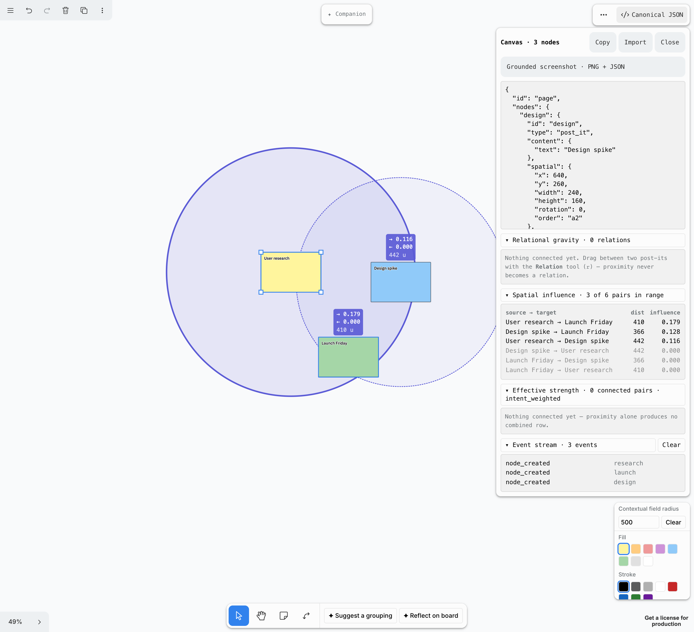
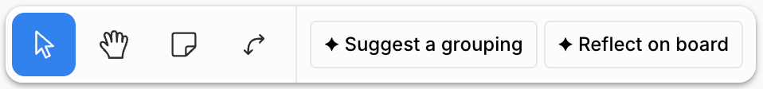
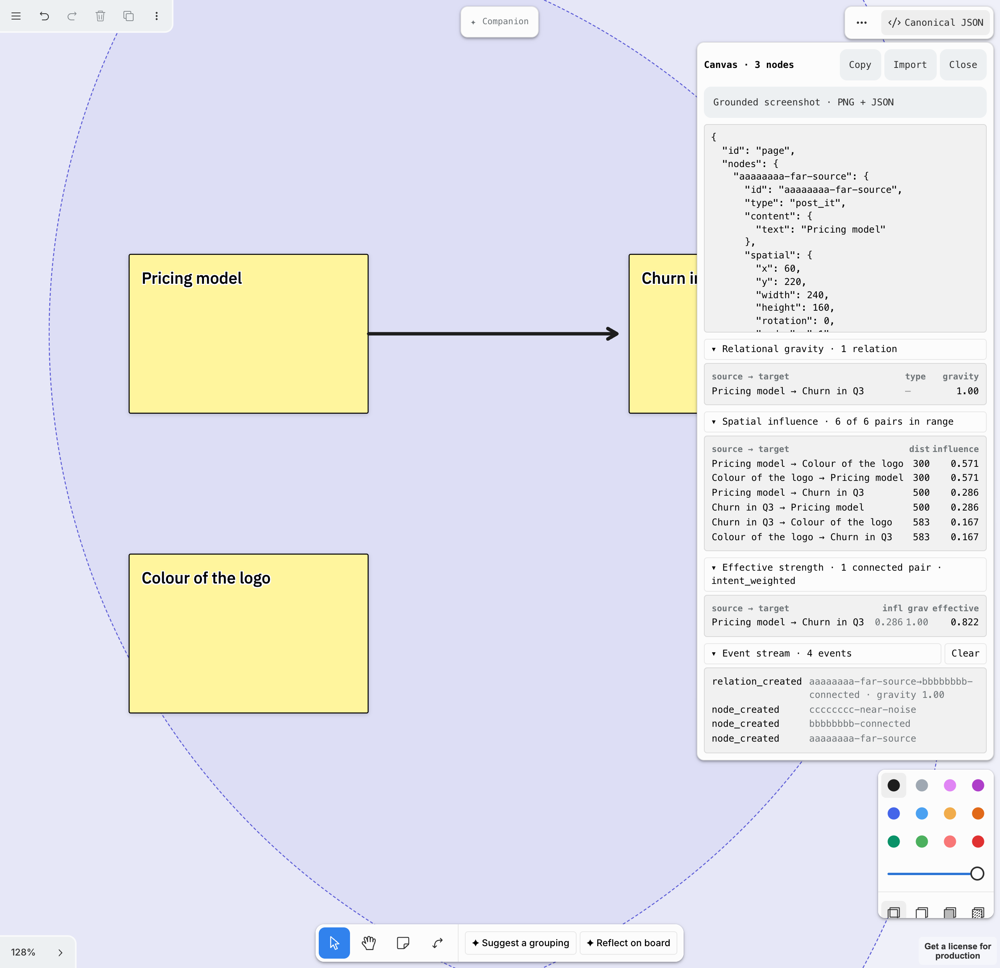
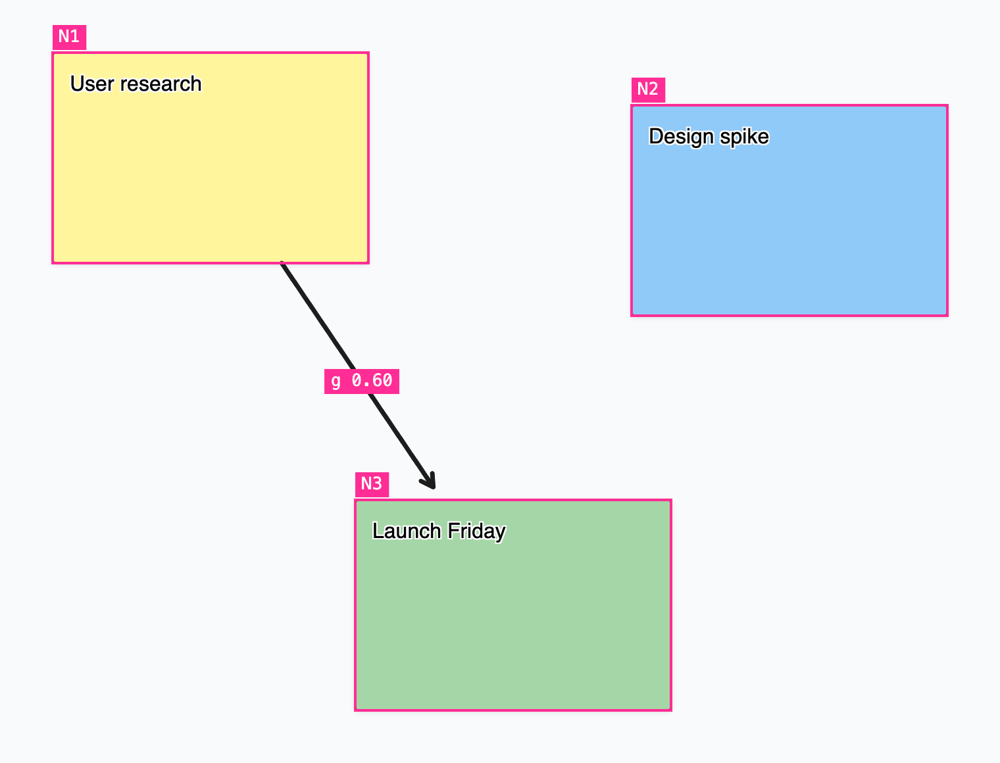
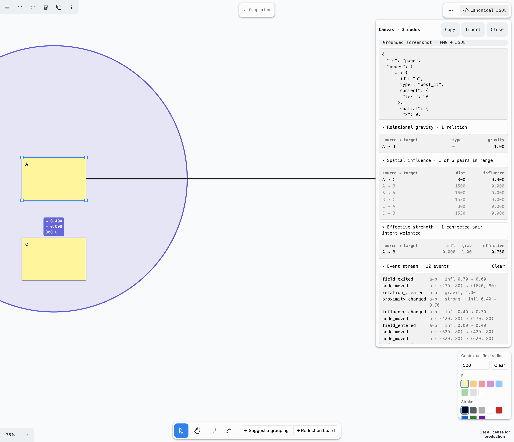
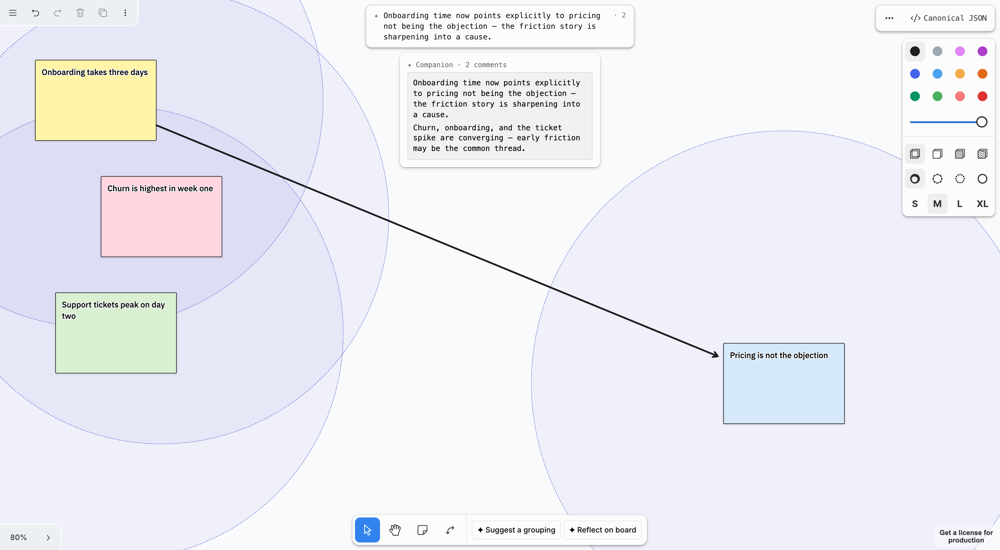
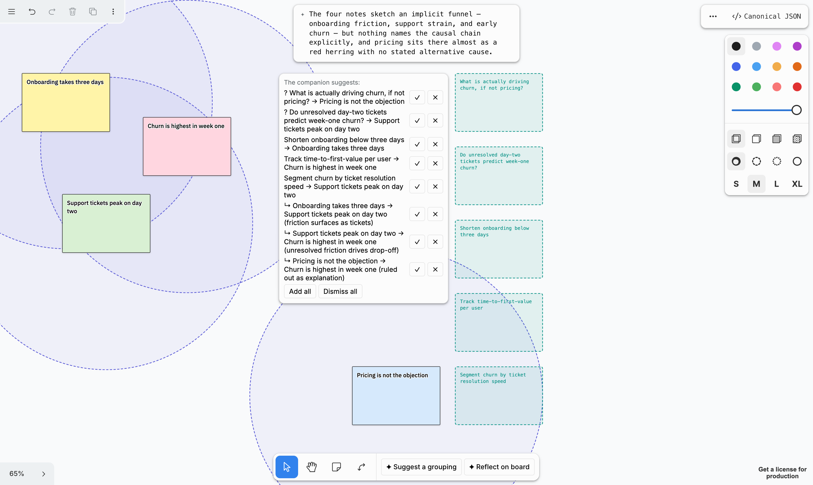

# llm-spatial-context

An experiment in letting a language model read a [tldraw](https://tldraw.dev) canvas the way the person arranging it does. Every post-it's text, position, reach and drawn connections come out as one JSON document, and that document keeps what the user said apart from what the layout merely implies. An AI companion watches the document change and, now and then, says something about it.

Built with tldraw, Vite, React 19 and TypeScript, plus a small Hono server that holds the API keys.



## The idea

When someone moves a note closer to another, groups a few, or draws a line between two, the content often stays the same. The arrangement is what changed. This prototype bets that the arrangement is part of the thinking, and asks what happens when a model can observe it directly.

The canvas gives a model three kinds of evidence, and the design keeps them apart:

| Signal             | Question it answers                   | Kind of evidence |
| ------------------ | ------------------------------------- | ---------------- |
| Content            | What does the note say?               | Semantic         |
| Spatial influence  | How are the notes arranged?           | Implicit         |
| Relational gravity | What did the user explicitly connect? | Explicit         |

Two notes can sit close together with no connection, or be connected while far apart. A single "relationship" score would erase exactly that difference. In a hand-run test with Gemini, the arrows on a board said `N4 → N1` and `N3 → N2`, while the notes' text implied a chain `N4 → N3 → N1 → N2`. Because the signals arrived separately, the model reported both structures instead of blending them into one graph.

A board also changes while someone thinks, and I suspect the change says more than the final state. So the companion reacts to changes, not to the board as it stands.

The full argument is in [`docs/why.md`](./docs/why.md).

## Getting started

Requires Node `>=22.12.0` (a tldraw requirement).

```bash
npm install
cp .env.example .env   # add ANTHROPIC_API_KEY and OPENAI_API_KEY
npm run dev
```

Open http://localhost:5173. `npm run dev` starts Vite on `5173` and the companion's API server on `8787`, and Vite proxies `/api/*` to it.

The two keys are only for the companion: Anthropic for its reasoning, OpenAI for its voice. Without them the companion stays silent and everything else works.

In development, run `window.seedDemoScene()` in the browser console for a three-note scene to drag around.

## Using it



- **Post-it** (`p`) adds a note. New notes start with a 500-unit contextual field, their reach on the canvas. Select a note to change the radius in the style panel.
- **Relation** (`r`) draws an arrow from one note to another. Double-click the arrow to type a label, which becomes the relation's `type`. Select it to set its gravity, from 0 to 1, in the style panel.
- **✦ Suggest a grouping** and **✦ Reflect on board** ask the companion to propose changes. Proposals appear as ghosts and land on the canvas only when you accept them.
- **⋯** (top right) holds four switches: contextual fields, AI observation, voice, and follow, which moves the camera to whatever the companion is talking about.
- **`</>`** opens the Inspector: the live canonical JSON, the strength tables, the event log, and the **Grounded screenshot** export.
- The companion's latest remark shows at the top centre. Click it for the full transcript.

The rest of tldraw's tools are off the toolbar but keep their keyboard shortcuts.

## How it works

The canonical model owns what things are, tldraw stores and renders them, and an adapter is the only code that touches both. tldraw's store is the single source of truth. The JSON document is derived from it on every read, so there is no second copy to fall out of step.

### Four layers of context

| Layer                     | Where in the JSON                            | Answers                                                       |
| ------------------------- | -------------------------------------------- | ------------------------------------------------------------- |
| Node spatial state        | `nodes[].spatial`, `nodes[].contextualField` | Where is it, how big, how far does it reach?                  |
| Spatially derived context | `spatialContext.influences`                  | How far apart are two notes, how strongly does one reach out? |
| Explicit relations        | `relations`                                  | What did the user connect, what did they call it, how firmly? |
| Visual grounding          | `grounding`                                  | Which pixels of a screenshot is this note?                    |

```json
{
	"nodes": {
		"node-a": { "spatial": { "x": 300, "y": 200, "…": "…" }, "contextualField": { "radius": 500 } }
	},
	"relations": {
		"relation-1": { "from": "node-a", "to": "node-b", "gravity": 1, "type": "causes" }
	},
	"spatialContext": {
		"influences": [{ "source": "node-a", "target": "node-b", "distance": 326, "influence": 0.349 }],
		"effectiveStrengths": [
			{
				"source": "node-a",
				"target": "node-b",
				"influence": 0.349,
				"gravity": 1,
				"effectiveStrength": 0.837,
				"strategy": "intent_weighted",
				"relations": ["relation-1"]
			}
		]
	},
	"grounding": {
		"image": { "width": 1998, "height": 1140 },
		"nodes": { "N1": { "nodeId": "node-a", "bbox": [80, 80, 560, 400] } }
	}
}
```

Three rules hold across the layers:

- Derived values are never stored. Influence, effective strength and grounding are recomputed on every read and ignored on import.
- Proximity never becomes a relation, and a relation never becomes influence. `relations` holds only the arrows the user drew.
- Absent is not zero. A note with no field reaches nothing, which is a different claim from a small field. An unlabelled arrow has no `type`, rather than an invented `related_to`.

Influence falls off linearly with centre-to-centre distance, from 1 when two centres coincide to 0 at the source's field radius. It is directional: two notes with different radii reach each other by different amounts.

`spatialContext.effectiveStrengths` combines the two strength signals for the pairs the user connected, so a reader can rank them. Each row carries both inputs and names the function that combined them. The default, `intent_weighted`, gives the user's gravity three times the weight of proximity.



On this board, proximity ranks `Pricing model → Colour of the logo` highest at `0.571`, though the user never connected them. `Pricing model → Churn in Q3` has half that influence, but it is the pair the user drew an arrow between, and its effective strength is `0.822`.

The **Grounded screenshot** button exports a PNG with every note outlined and labelled `N1`, `N2`… and every relation badged `R1`, `R2`… with its gravity. The `grounding` block maps each label to its id and its pixel bounding box, so a model handed the image and the JSON doesn't have to guess which pixels belong to which note. Nothing derived is drawn on the export.



### Event stream

`diffCanvas(before, after)` compares two documents, and `deriveEvents` restates the difference as an ordered list of events:

```text
structural   node_created · node_deleted · node_moved · contextual_field_changed
             relation_created · relation_deleted · relation_rebound · relation_gravity_changed
spatial      field_entered · field_exited · influence_changed · proximity_changed
```

An event describes the change between two moments, so it is never part of the document. The stream is an in-memory buffer you can subscribe to, fed by a single store subscription (`registerSpatialEvents`). The Inspector's event log shows it live.

Below, note B has been dragged out of A's field. Influence fell to 0, the A → B relation still stands at gravity 1.00, and the log shows `field_exited` but no `relation_deleted`. Moving a note can't revoke a connection the user made.



### The AI companion

`src/companion/` subscribes to the stream and groups events into episodes, one per pause. A cheap local check drops noise. Whatever survives goes to `/api/observe`, where the model decides whether to say anything. Usually it doesn't, and that silence comes back as a structured answer (`{ speak: false }`), not as an error.

When it does speak, the remark joins a queue and is voiced in the order the gestures happened. A remark that has gone stale by its turn, because it is too old or no longer matches the board, is dropped without being said. From the moment you stop dragging to the first spoken word takes about 5 to 6 seconds, most of it the model call.



Two more agents run when asked. **✦ Suggest a grouping** proposes which notes belong together, and can also offer one unprompted when an observation comes back silent, at most once a minute. **✦ Reflect on board** reads the board through a lens you pick (critique, analyzer, gap-finder or synthesizer) and proposes notes and arrows to add. The model picks; the client places, because models are poor at coordinates. Every proposal stays a ghost until you accept it, and each accept is one undo step. A fourth agent, the digest, keeps a running reading of what the board is about and hands it to the other three.



All model calls go through five Hono routes in `server/`: `/api/observe`, `/api/suggest`, `/api/reflect`, `/api/digest` and `/api/speak`. They exist to keep both API keys out of the browser, which is the only reason this project has a backend.

## Developing

| Script              | Does                                                                          |
| ------------------- | ----------------------------------------------------------------------------- |
| `npm run dev`       | Vite with HMR and the API server, together                                    |
| `npm run build`     | Typecheck client and server, then build to `dist/`                            |
| `npm start`         | Serve a built `dist/` and the API from one process                            |
| `npm test`          | Vitest, single run                                                            |
| `npm run typecheck` | `tsc --noEmit` for both tsconfigs                                             |
| `npm run lint`      | ESLint                                                                        |
| `npm run format`    | Prettier                                                                      |
| `npm run eval`      | The observer against fixtures, live. Calls a paid API; not part of `npm test` |

`dev:web`, `dev:api`, `preview`, `test:watch`, `lint:fix` and `format:check` do what their names say.

`src/domain` is the canonical model and never imports tldraw; ESLint enforces it. `src/canvas/adapter` is the only code that knows both sides. State tldraw has no field for, such as `contextualField`, `gravity` and the timestamps, lives in `shape.meta`. Imports resolve `@/` to `src/`. [`CODEMAP.md`](./CODEMAP.md) maps every file.

### Where to add things

- A node type: `NodeType` in `src/domain/node.ts`, a shape util and tool in `src/canvas/shapes/`, then the adapter.
- A custom shape: copy `src/canvas/shapes/PostItShapeUtil.tsx` and register it in `customShapeUtils` in `src/canvas/config.tsx`.
- A custom tool: copy `src/canvas/shapes/PostItTool.ts`, then register it in `customTools`, `uiOverrides` and the `Toolbar` override, all in `src/canvas/config.tsx`.
- Code that needs the editor: the `onMount(editor)` callback in `src/canvas/Canvas.tsx`.
- Another way to combine the strength signals: a `CombineStrategy` in `STRATEGIES` in `src/domain/effectiveStrength.ts`.
- A new event: the change kind in `src/domain/canvasDiff.ts` first, then the `SpatialEvent` union and `deriveEvents` in `src/domain/events.ts`, then a line in `describeEvent` in `src/canvas/ui/EventLogPanel.tsx`.
- Something that watches the canvas: `spatialEventStream.subscribe(fn)` from `@/domain`, never a second store subscription.
- What the companion says: `SYSTEM_PROMPT` and `renderEpisode` in `server/prompt.ts`. Models and voice are set in `.env` (see `.env.example`).
- More of the board reaching the observer, such as text edits: add it upstream as a change kind and an event, then carry it through `buildEpisodeSummary`. Don't special-case it in the companion.

### Testing

`npm test` runs three layers: pure tests in a `node` environment, tests against a real tldraw `Editor` in `jsdom`, and rendered-component tests. The pure layer alone let two real bugs ship, which is why the other two exist. The companion runs against fake clients and a fake clock, so no test touches the network; `npm run eval` is the only thing that calls the real models. [`CODEMAP.md`](./CODEMAP.md) lists the test files per layer.

### Persistence

The canvas is saved to IndexedDB through tldraw's `persistenceKey` in `src/canvas/Canvas.tsx`, so it survives a reload and syncs between tabs. Changing a registered shape type without a migration breaks stored records; bump the key when you do.

## Known limitations

- There are no image nodes. `post_it` is the only node type.
- Attention isn't modelled. Selecting a note changes what you see, but selection never reaches the document or the companion.
- Editing a note's text fires no event. The companion reads the new text on its next call, but a rewrite never prompts one.
- The observer never edits the board itself. Changes come only from the grouping and reflection agents, and only once you accept them.
- An accepted agent arrow is indistinguishable from the user's own in `relations`. Its `createdBy: 'agent'` lives only in the arrow's shape `meta`.
- Without API keys the companion is silent, which looks the same as having nothing to say.
- `INTENT_WEIGHT` (0.75), the proximity bands (0.66 and 0.33) and `TRIVIAL_INFLUENCE_EPSILON` (0.05) are guesses. Nothing measures them against a task yet.
- Rebuilding a canvas from JSON keeps text and relations but loses text formatting and arrow bends.
- Deleting a note leaves its arrow on the canvas unbound, and the relation drops out of `relations`.
- The event log and the companion's transcript live in memory only. A reload clears them.
- `shape.meta` patches merge key by key, and an `undefined` anywhere fails validation. Use `null` to clear a field.
- One canvas is one tldraw page.

## Further reading

- [`docs/why.md`](./docs/why.md) is the research note behind the prototype.
- [`CODEMAP.md`](./CODEMAP.md) covers every file, its key exports, and the invariants the code keeps.
- `node_modules/tldraw/DOCS.md` and `node_modules/tldraw/RELEASE_NOTES.md` document the installed tldraw version. v5 changed many APIs, so prefer them over older docs online.

tldraw runs without a license key on localhost. A production deployment needs a `licenseKey`; see [tldraw.dev/pricing](https://tldraw.dev/pricing).
